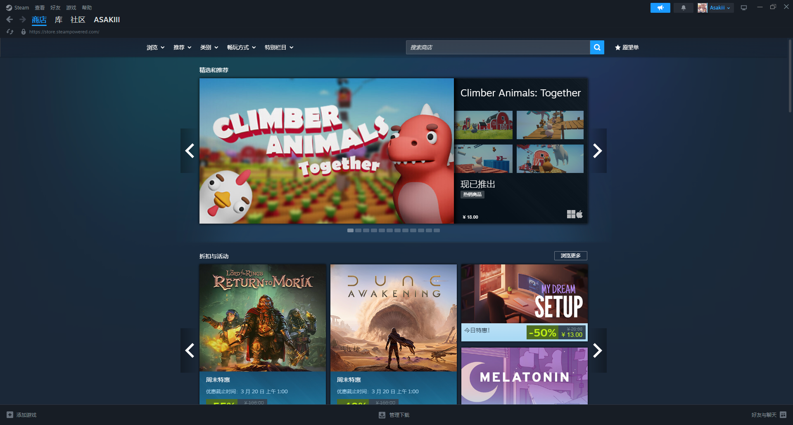
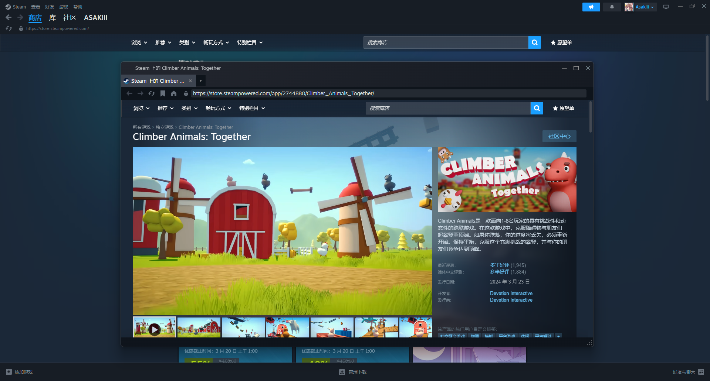
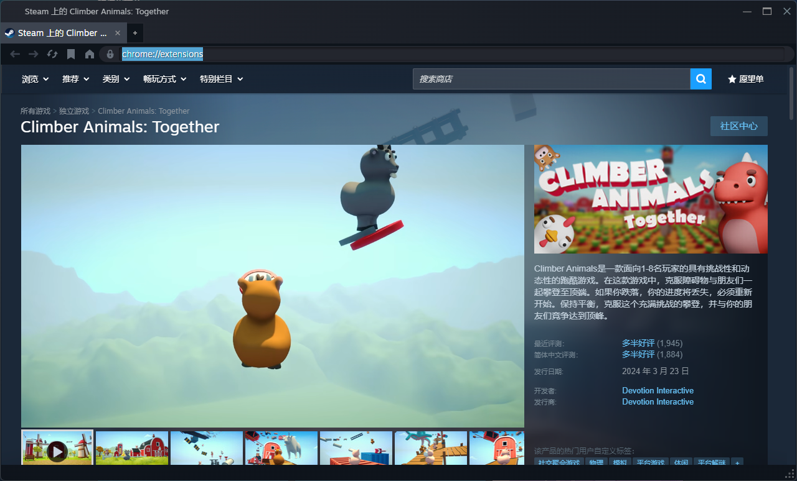
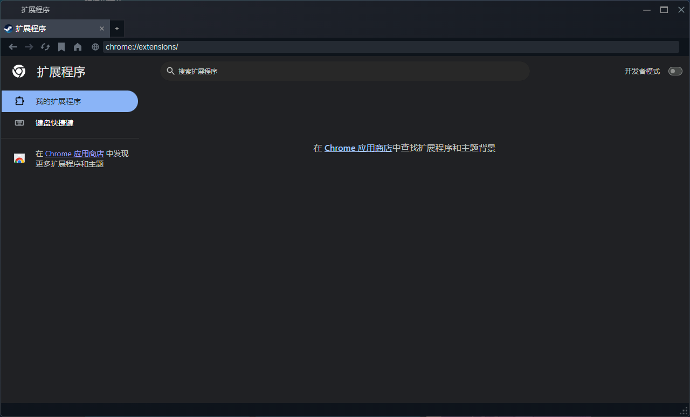
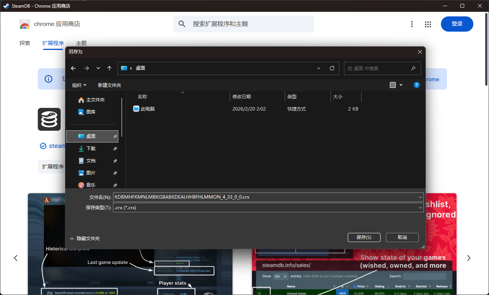
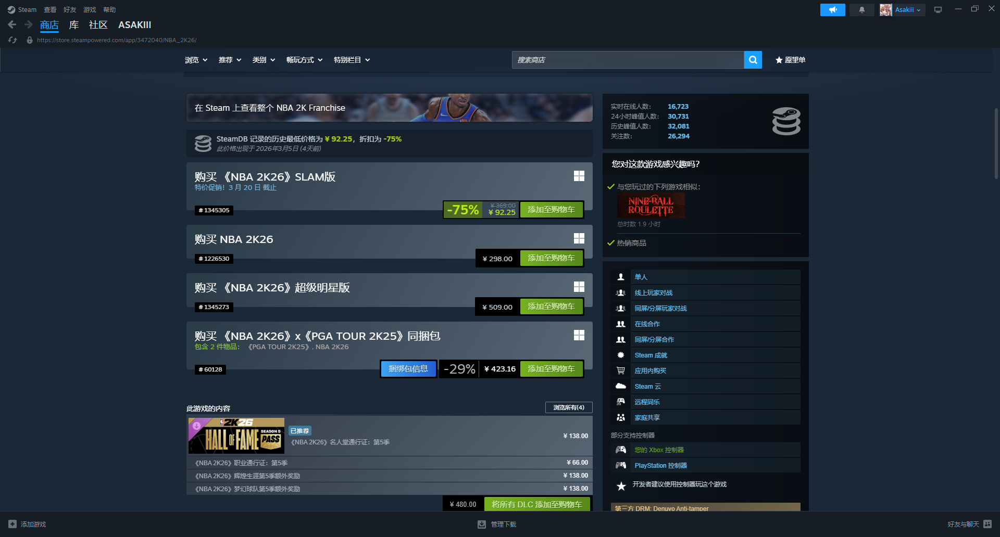

# 前言
Steam 作为全球最大的游戏平台，可以说是必装软件之一了。但是它的客户端缺失的一些功能却又恰恰是玩家们需要的，而且在中国大陆地区 Steam 的访问速度也是不尽如人意... 那么在本期文章中，我将给你的 Steam 施展得劲の魔法❤️让它变得更加好用(＾.＾)✌️
# 优化与 Steam 服务器的连接
首先来解决一下访问速度的问题，大家可能首先想到的是 Steam++，也就是现在的 Watt Toolkit

::github{repo="BeyondDimension/SteamTools"}

是的，它很好用，但是现在的它广告多，启动速度很慢。
因此，我推荐使用另一位大佬 [羽翼城 | Dogfight360](https://www.dogfight360.com/blog/author/wu360463231/) 开发的软件：Steamcommunity 302
[Steamcommunity 302 下载](https://www.dogfight360.com/blog/18682/)
软件界面简洁，无广，且支持多种平台加速

# 给 Steam 安装扩展
Steam 客户端是基于 Chromium 的，某种意义上 Steam 客户端就是一个浏览器套壳，基于此我们可以加装扩展，来拓展 Steam 的使用体验~
#### 查看史低价格

安装 SteamDB，首先正常启动 Steam，并打开 商店 页面


然后，用鼠标滚轮（中键）点击任意一款游戏，Steam 会弹出新窗口


在地址栏输入 “chrome://extensions”，然后敲击键盘 回车（Enter）


点击左侧 “Chrome 应用商店”，进入 Chrome 网上应用商店


搜索 SteamDB，点击 添加至 Chrome，新弹出的窗口会询问你保存位置，直接点击保存即可


此时 SteamDB 扩展已安装完成，回到 商店 页面，随意点击一款游戏，能看到 SteamDB 数据，安装完成~


#### 市场比价、批量上架，批量购买、一键徽章合成等

安装 Steam Inventory Helper，操作同上
#### Steam 崩溃了怎么办？

首先在 文件资源管理器 中，打开 显示隐藏文件，然后进入以下位置
```bash
C:\Users\你的用户名\Appdata\Local\Steam\htmlcache\Default\Extensions
```
删除拓展后重启 Steam 即可